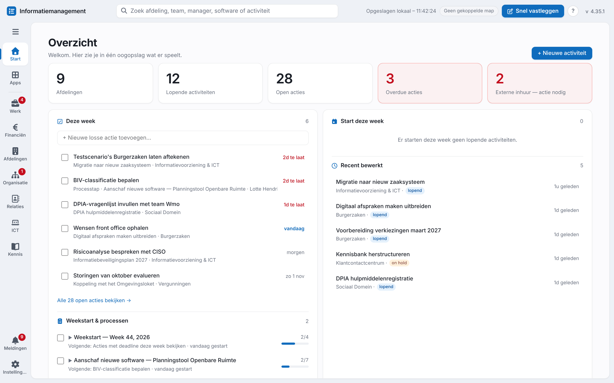
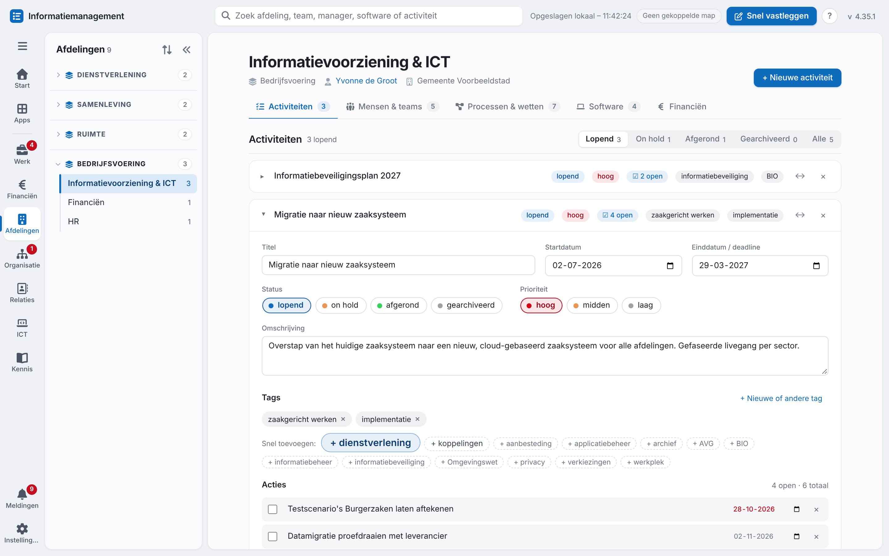
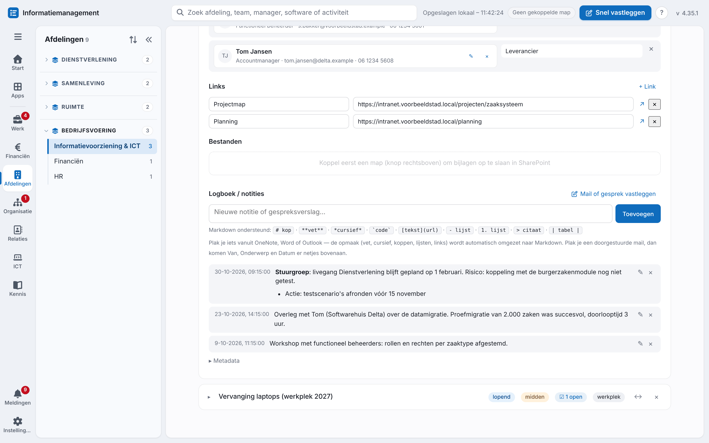
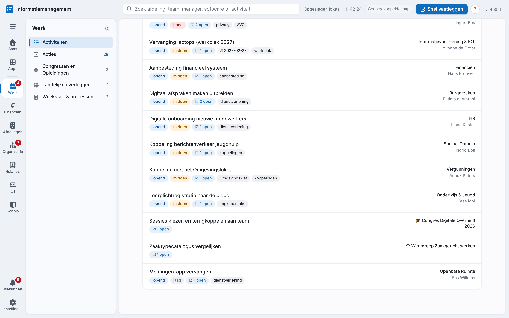
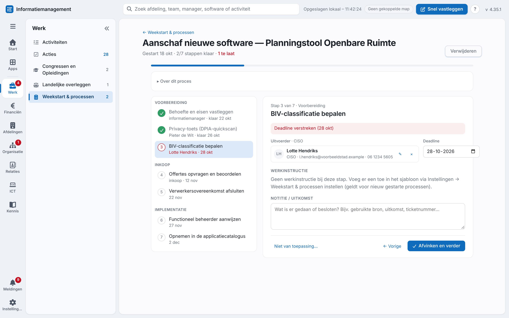
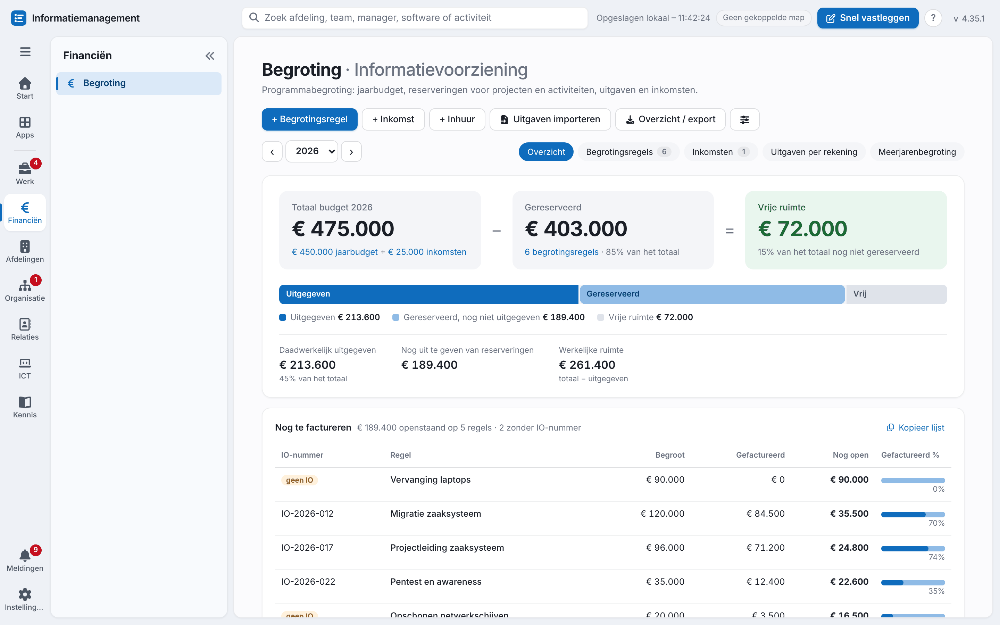
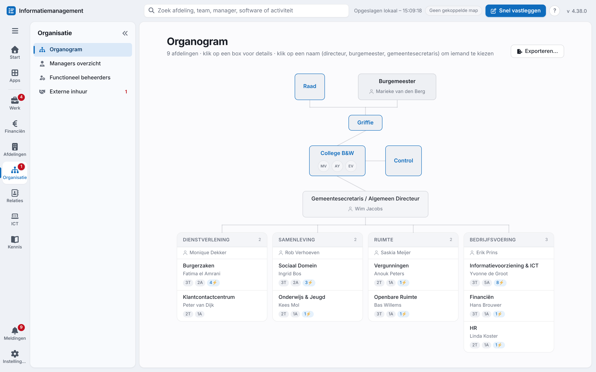
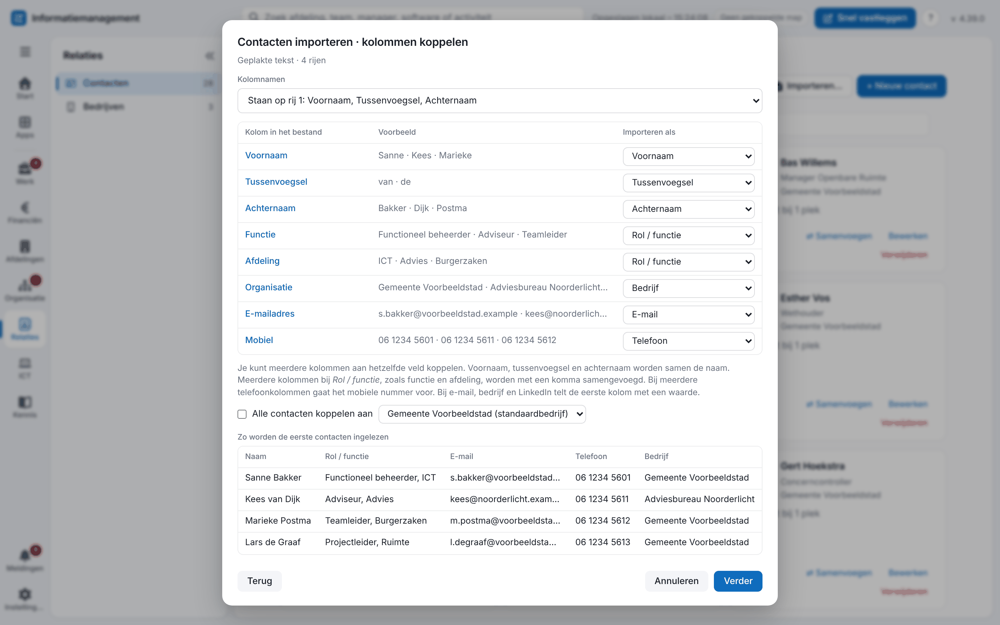
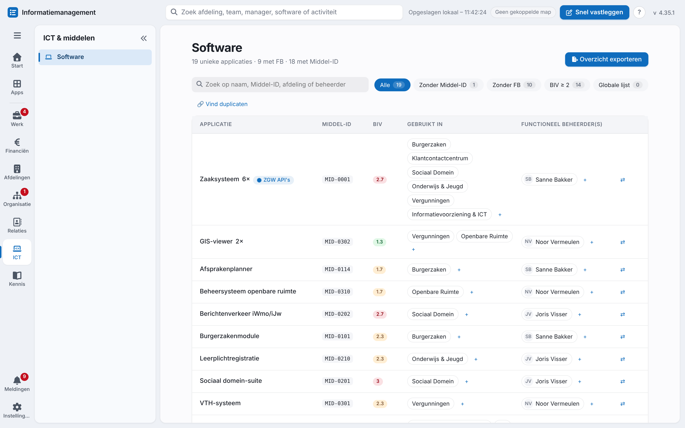

# Informatiemanagement-tool

**Eén overzichtelijke werkomgeving voor informatiemanagers bij gemeenten.**
Houd per afdeling bij wat er speelt (activiteiten, acties, processen, wet- en regelgeving en software) en houd grip op je begroting, externe inhuur, functioneel beheer en terugkerende processen. Alles zit in één HTML-bestand dat in je browser draait. Je gegevens blijven bij jou.

**[▶ Open de tool](https://mmulder82.github.io/informatiemanagement-tool/)** · [Hoofdfuncties](#hoofdfuncties) · [Aan de slag](#aan-de-slag) · [Waar staan je gegevens?](#waar-staan-je-gegevens) · [Licentie: EUPL-1.2](#licentie)



<sub>Alle schermafbeeldingen tonen een verzonnen gemeente ("Voorbeeldstad") met fictieve gegevens.</sub>

---

## Waarom deze tool?

Als informatiemanager werk je met veel afdelingen tegelijk. Je hebt lopende projecten, vragen en toezeggingen, applicaties met hun functioneel beheerders, externe inhuur met contracten die aflopen, een budget dat bewaakt moet worden en processen die je af en toe opnieuw doorloopt. Die informatie raakt al snel verspreid over mail, notities en spreadsheets.

Deze tool brengt alles samen op één plek, ingedeeld zoals een gemeente werkt: sectoren, afdelingen, het college en de organisatie eromheen. Er is geen installatie, geen account en geen server nodig.

---

## Hoofdfuncties

### Dagelijks werk

- **Dashboard.** Je ziet in één oogopslag wat er vandaag speelt: kengetallen, alle acties met een deadline deze week (te laat in rood), lopende weekstarts en processen, recent bewerkte activiteiten en een vrij aantekeningenveld.
- **Activiteiten per afdeling.** Een activiteit is alles waar je mee bezig bent: een project, een vraag of een traject. Per activiteit leg je vast:
  - status, prioriteit, start- en einddatum en tags;
  - acties met deadlines;
  - contactpersonen, links en bijlagen;
  - een logboek.
- **Logboek en Snel vastleggen.** Leg notities en gespreksverslagen vast met eenvoudige opmaak (Markdown).
  - Plakken uit Outlook, Word, OneNote of Excel behoudt koppen, lijsten, links en tabellen.
  - Een doorgestuurde mail krijgt automatisch Van, Onderwerp en Datum bovenaan.
  - Met **Snel vastleggen** (⌘⇧L of Ctrl+Shift+L) zet je een mail of gesprek vanuit elk scherm bij de juiste activiteit.
- **Activiteiten- en Acties-overzicht.** Je ziet alle activiteiten en open acties van alle afdelingen in één lijst. Je kunt zoeken en filteren op afdeling, manager, status en tag.
- **Weekstart & processen.** Werk met terugkerende checklists en draaiboeken, bijvoorbeeld *Aanschaf nieuwe software*.
  - Elke stap kan een werkinstructie, een uitvoerder uit je contacten, een fase en een deadline hebben.
  - Een bestaande werkinstructie uit Word of Markdown zet je met één import om in een sjabloon.
- **Congressen, opleidingen en landelijke overleggen.** Per congres, opleiding of overleg houd je activiteiten, acties en verslagen bij.
- **Meldingen.** Het belletje waarschuwt voor acties die te laat zijn, aflopende contracten en komende bijeenkomsten. Desgewenst krijg je ook een systeemmelding.
- **Zoeken.** Eén zoekveld doorzoekt activiteiten, acties, mensen, software, processen, standaarden en meer.









### Financiën

- **Begroting per programma.** Per programma beheer je:
  - het jaarbudget en een meerjarenbegroting;
  - begrotingsregels met grootboekrekening, inkooporder (IO-nummer) en contractnummer;
  - inkomsten zoals subsidies.
- In één blik zie je **budget − gereserveerd = vrije ruimte**, wat er daadwerkelijk is uitgegeven en wat er nog gefactureerd moet worden.
- **Uitgaven importeren.** Je leest een rapport met crediteurtransacties uit het financiële systeem in (Excel of CSV). De app koppelt de transacties via het IO-nummer aan de juiste begrotingsregels.
- Externe inhuur kan rechtstreeks ten laste van de begroting komen. De kosten worden dan per jaar berekend.
- Je kunt het overzicht exporteren naar Excel of PDF.



### Organisatie

- **Sectoren en afdelingen** richt je zelf in. Per afdeling leg je vast:
  - de manager (met foto), de teams en het bedrijf;
  - hoofdprocessen en wet- en regelgeving;
  - de applicaties die de afdeling gebruikt;
  - de gekoppelde functioneel beheerders en externe inhuur.
- **Organogram.** Je ziet de bestuurlijke opbouw: raad, griffie, College B&W, Control, de gemeentesecretaris en de sectoren met hun afdelingen. Per collegelid houd je de portefeuille, acties en notities bij. De burgemeester, de gemeentesecretaris en de directeuren van de sectoren kies je hier uit je contacten.
  - Je exporteert het organogram als afbeelding (PNG of SVG) voor een presentatie of document, of als PDF om af te drukken. Je kiest zelf of namen, foto's en teams erin staan, voor de hele organisatie of één sector. Je kunt het ook direct kopiëren en in PowerPoint, Word of Teams plakken.
- **Functioneel beheerders.** Je registreert wie welke applicaties beheert, voor welke afdelingen.
- **Externe inhuur.** Hier staan per inhuur:
  - de contractperiode, het aantal mogelijke verlengingen en de verlengduur;
  - uren per week, het uurtarief en de inkooporder;
  - periodieke beoordelingen.

  De app signaleert op tijd wanneer een contract verlengd moet worden en houdt de verlengingshistorie bij.



### Relaties

- **Contacten** staan in één centraal register: naam, rol, e-mail, telefoon, bedrijf, LinkedIn en foto. Overal waar iemand gekoppeld is, worden wijzigingen direct overgenomen. Ook managers, directeuren, de burgemeester, de gemeentesecretaris, collegeleden en de personen bij Control komen hier automatisch in. Dubbele contacten voeg je eenvoudig samen.
- **Contacten importeren** uit een CSV- of Excel-bestand met elke indeling, bijvoorbeeld een export uit Outlook of Google of een eigen lijst.
  - Je kiest per kolom of hij wordt ingelezen en bij welk veld hij hoort. Meerdere kolommen kunnen samen één veld vormen, zoals voornaam en achternaam.
  - Met één vinkje koppel je alle contacten aan hetzelfde bedrijf, bijvoorbeeld je eigen organisatie. Staan er meerdere telefoonnummers in het bestand, dan wordt het mobiele nummer gekozen.
  - Staat iemand al in je contacten, of komt iemand twee keer voor in het bestand? Dan worden de gegevens aangevuld in plaats van dubbel aangemaakt.
  - Je ziet vooraf per persoon wat er gebeurt, en je kunt de import daarna nog ongedaan maken.
- **Bedrijven** leg je één keer vast en koppel je aan contacten, managers en collegeleden.
- Optioneel synchroniseer je contacten met een telefoonnummer naar **Contacten op je iPhone en Mac**. Zie [hieronder](#contacten-synchroniseren-met-iphone-en-mac-optioneel).



### ICT en kennis

- **Software-catalogus.** Per applicatie zie je de Middel-ID, de BIV-classificatie, welke afdelingen hem gebruiken en wie de functioneel beheerders zijn.
  - Filters tonen bijvoorbeeld applicaties zonder Middel-ID, zonder beheerder of met een hoge BIV.
  - Je kunt importeren uit een Topdesk-export (Excel), dubbele applicaties opsporen en samenvoegen, en een deelbaar applicatie-overzicht maken.
- **Processen en wet- en regelgeving.** Je ziet welke processen en wetten bij meerdere afdelingen terugkomen.
- **Standaarden.** Leg vast met welke open standaarden je werkt (zoals ZGW API's, NEN 2082, StUF en DigiD). Je ziet de status bij de gemeente en of de standaard volgens Forum Standaardisatie verplicht of aanbevolen is.
- **Apps.** Je eigen bibliotheek met links naar applicaties en portalen, gegroepeerd per categorie.



### Importeren en exporteren

Alles staat bij elkaar onder Instellingen → **Importeren & exporteren**.

- **Volledige back-up** als JSON-bestand.
- **Basisdata delen** met een collega. Dat is alleen de organisatiestructuur, managers, processen, wetten, software en beheerders, zonder je activiteiten en notities.
- **Exporteren naar Excel, CSV of PDF** voor afdelingen, activiteiten, functioneel beheerders, applicaties, externe inhuur, begroting en contacten. Je kiest zelf de kolommen.
- **Organogram** als afbeelding (PNG of SVG) of als PDF.
- **Applicatie-overzicht** als losse webpagina die iedereen kan openen, doorzoeken en afdrukken.
- **Contacten importeren** uit CSV of Excel, met elke indeling. Bestaande contacten worden aangevuld.
- **Markdown-bestand per activiteit** in je gekoppelde map. Zo vind je activiteiten ook terug met Spotlight, Verkenner of Obsidian.

De ingebouwde **Help & handleiding** (de knop **?** rechtsboven, of F1) legt elk onderdeel stap voor stap uit.

---

## Aan de slag

1. **Open de tool** in Chrome of Edge: <https://mmulder82.github.io/informatiemanagement-tool/>
2. **Koppel een map** (aanbevolen). Ga naar Instellingen (het tandwiel linksonder) → **Map koppelen** en kies een map, bij voorkeur een map die met OneDrive of SharePoint synchroniseert. De app slaat alles automatisch op in `tracker-data.json` in die map, met een reservekopie.
3. **Richt je organisatie in** via Instellingen → **Sectoren & afdelingen beheren**. Heeft een collega de tool al ingericht? Dan kun je ook zijn basisdata importeren.
4. **Stel je gemeente in als standaardbedrijf** (optioneel). Dat doe je met de ster bij Relaties → Bedrijven. Nieuwe afdelingen en managers krijgen het bedrijf dan automatisch.
5. **Begin.** Met **+ Nieuwe activiteit** op het dashboard leg je je eerste activiteit vast.

> **Als app installeren.** In Edge en Chrome kun je de tool installeren als app, met het installatie-icoon in de adresbalk. In Edge kan het ook via het menu, onder **Apps**. De tool opent dan in een eigen venster en krijgt een eigen icoon in de Dock of de taakbalk. Je gegevens blijven dezelfde als in het tabblad. Dit werkt met de online versie, niet met een gedownload bestand.

> **Liever lokaal?** Download `index.html` en open het bestand in Chrome of Edge. Ook dat werkt volledig. De browser bewaart gegevens per adres. Wissel je tussen de online versie en een lokaal bestand, koppel dan in beide dezelfde map. Dan werk je steeds met hetzelfde `tracker-data.json`.

---

## Waar staan je gegevens?

- **Er is geen server en geen account.** De tool draait helemaal in je browser. GitHub levert alleen het bestand. Je gegevens gaan nooit naar GitHub of naar een andere server.
- Alles wordt bewaard in de **lokale opslag van je browser**. Heb je een map gekoppeld, dan ook in **`tracker-data.json`** in die map, met **`tracker-data.bak.json`** als reservekopie.
- Werk je op twee computers of in twee vensters tegelijk, dan herkent de app dat en voegt hij de wijzigingen samen.
- De app maakt maar een paar verbindingen met internet:
  - Bij importeren of exporteren naar Excel laadt hij de bibliotheek [SheetJS](https://sheetjs.com) van cdnjs.
  - Voor de tegels in **Apps** haalt hij het icoon van een website op, van de website zelf of via de icoondienst van Google. Interne adressen, zoals intranet en SharePoint, worden nooit naar buiten gestuurd.
  - De LinkedIn-knoppen bij contacten openen LinkedIn in een nieuw tabblad.

---

## Contacten synchroniseren met iPhone en Mac (optioneel)

Wil je de contacten met een telefoonnummer ook op je telefoon hebben? In de map [`contacten-sync`](contacten-sync/) staat een klein achtergrondprogramma voor macOS. Het zet die contacten automatisch in een aparte groep in Contacten op je Mac en iPhone, via iCloud.

- Het programma draait alleen op je eigen Mac. Je app-specifieke Apple-wachtwoord staat alleen in de macOS-sleutelhanger.
- De tool en het programma worden aan elkaar gekoppeld met een **koppelcode**. Andere websites kunnen het programma daardoor niet aansturen of uitlezen.
- Het programma raakt alleen de contacten aan die het zelf heeft aangemaakt.

Installatie en uitleg vind je in [`contacten-sync/LEES-MIJ.md`](contacten-sync/LEES-MIJ.md).

---

## Browsers

| | Chrome / Edge | Safari / Firefox |
|---|:---:|:---:|
| De tool gebruiken (opslag in de browser) | ✓ | ✓ |
| Installeren als app, met eigen venster en icoon | ✓ | alleen Safari |
| Map koppelen, back-ups en bijlagen | ✓ | – |
| Markdown-bestanden per activiteit | ✓ | – |
| Contacten synchroniseren met iPhone/Mac | ✓ | – |

Map koppelen gebruikt de *File System Access API*, die alleen Chrome en Edge ondersteunen.

---

## Techniek

- **Eén bestand** (`index.html`) met HTML, CSS en JavaScript. Er is geen build-stap, geen framework en geen installatie.
- De enige externe bibliotheek is [SheetJS](https://sheetjs.com) voor Excel. Die wordt pas geladen als je hem nodig hebt.
- Iconen: [Font Awesome Free](https://fontawesome.com) (CC BY 4.0), inline opgenomen als SVG.
- Gegevens worden opgeslagen als JSON. Oudere gegevensbestanden blijven altijd inlaadbaar.
- De contacten-sync gebruikt alleen Python 3 uit macOS zelf, zonder extra pakketten.

```
index.html          de tool
contacten-sync/     optioneel achtergrondprogramma voor iPhone/Mac
screenshots/        afbeeldingen voor deze README
LICENSE             de licentie (EUPL-1.2)
```

---

## Licentie

Deze tool is open source onder de **European Union Public Licence v1.2** ([EUPL-1.2](LICENSE)). In het kort mag je de tool gebruiken, aanpassen en verder verspreiden, ook binnen je eigen organisatie. Verspreid je een aangepaste versie, of stel je die online beschikbaar? Dan doe je dat onder de EUPL (of een daarmee compatibele licentie) en maak je de broncode beschikbaar.

De EUPL is opgesteld door de Europese Commissie en is in alle officiële EU-talen even geldig, ook in het [Nederlands](https://joinup.ec.europa.eu/collection/eupl/eupl-text-eupl-12).

---

## Vragen en ideeën

Loop je ergens tegenaan of heb je een idee voor een verbetering? [Maak een issue aan](https://github.com/mmulder82/informatiemanagement-tool/issues).
